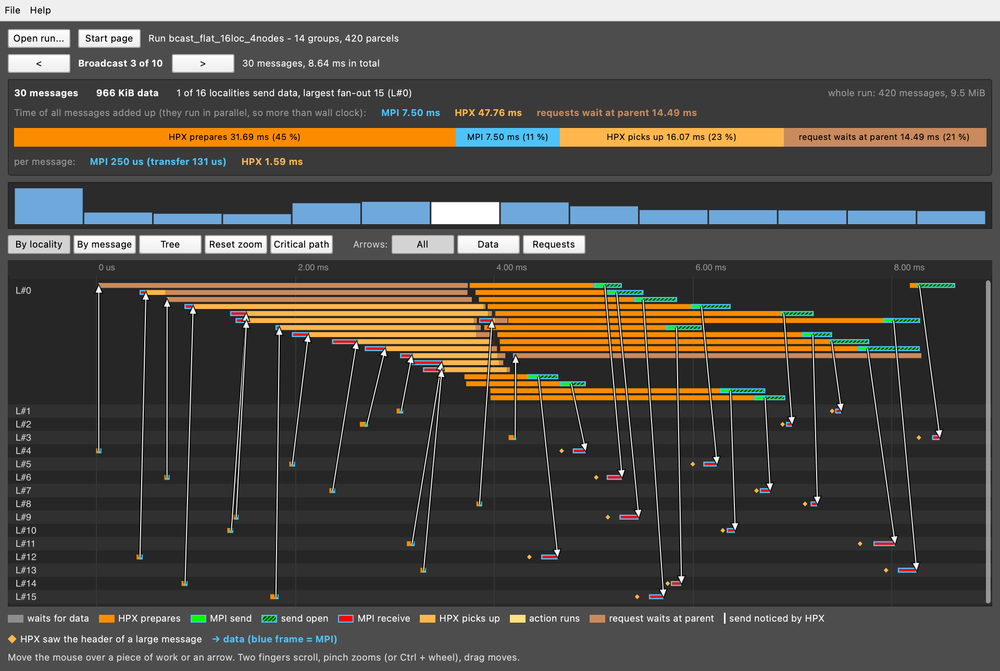
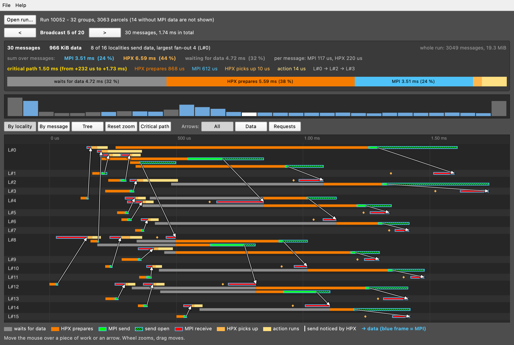
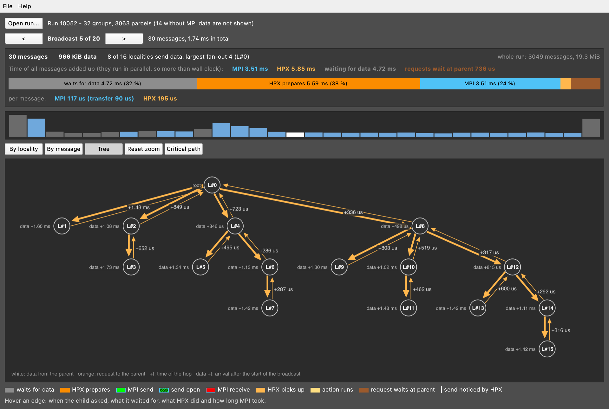

# EduHPX

EduHPX shows what happens inside an [HPX](https://github.com/STEllAR-GROUP/hpx) program and in the MPI messages below it,
on **one timeline**: when HPX prepares a parcel, when MPI sends and receives it, when HPX picks it up and runs the action.
Collectives (broadcast ...) are grouped, drawn as a tree and analysed along their critical path.

*One broadcast of 16 localities on 4 nodes: green = MPI send, red = MPI receive, blue frame = time in MPI, the rest is HPX.*

## Why EduHPX?

EduHPX is the little brother of **EduMPI Suite**: [EduMPI](https://github.com/AnnaLena77/EduMPI) (an Open MPI that records
MPI communication), EduStore (its database, a folder in the EduMPI repo) and the
[EduMPI GUI](https://github.com/AnnaLena77/EduMPI_GUI).

In [HPX](https://github.com/STEllAR-GROUP/hpx) you do not write sends and receives: HPX packs a remote call into a *parcel* and
sends it for you, over TCP, LCI or MPI. That is convenient, but when a program gets slow, it is hard to say whether the time is
lost in HPX (waiting, scheduling, preparing the parcel) or in the transport below it (the MPI send, the receive).

[HPX's Tracy integration](https://v4xsh.dev/blog/gsoc-2026-hpx-tracy/) (Google Summer of Code 2026) shows tasks, threads and the parcels of each locality, but not the MPI messages below them. EduMPI shows the MPI messages,
but knows nothing about parcels. **EduHPX puts both on one timeline**: for every parcel you see what HPX did and what MPI did.

## Download

Ready-made viewer (version 0.0.2), built by the workflows on the branch `deploy`:

| System | File |
|---|---|
| Linux | [`EduHPX_0.0.2-x86_64.AppImage`](https://github.com/FuldaHPC/tool-eduhpx/releases/download/v0.0.2/EduHPX_0.0.2-x86_64.AppImage): make it executable (`chmod +x`), then start it |
| macOS | [`EduHPX_0.0.2.dmg`](https://github.com/FuldaHPC/tool-eduhpx/releases/download/v0.0.2/EduHPX_0.0.2.dmg): the app is not signed, see the note below |
| Windows | [`EduHPX_0.0.2-windows.zip`](https://github.com/FuldaHPC/tool-eduhpx/releases/download/v0.0.2/EduHPX_0.0.2-windows.zip): unpack, start `eduhpx.exe` |
| Example run files | [`EduHPX_0.0.2_examples.zip`](https://github.com/FuldaHPC/tool-eduhpx/releases/download/v0.0.2/EduHPX_0.0.2_examples.zip), also built into the app: *File > Examples* |

All releases: <https://github.com/FuldaHPC/tool-eduhpx/releases>. The three downloads also contain the examples.

**macOS: the first start.** The app is not signed with an Apple certificate, so macOS blocks it once (it is not damaged):

- macOS 14 and older: right click on `EduHPX.app` > *Open* > *Open*.
- macOS 15 and newer: double click the app once (it is blocked), then *System Settings > Privacy & Security*, scroll down
  to the message about EduHPX and click *Open Anyway*.
- Or in the Terminal: `xattr -dr com.apple.quarantine /Applications/EduHPX.app`.

Copy `EduHPX.app` from the dmg to *Applications* first. This is needed only once.

## The parts

| Folder | What it is |
|---|---|
| [`gui/`](gui/) | The viewer (Qt 6). Opens a run file and shows the timeline. Runs on macOS, Linux and Windows. [Details and a tour of the window](gui/README.md) |
| [`scripts/`](scripts/) | `install-hpx.sh` (patched HPX), `eduhpx-run` (run a program, get `run.csv`) and `eduhpx-merge`. Tested on a Linux cluster with Slurm. [What works and what is missing](scripts/README.md) |
| [`examples/`](examples/) | Ready-made run files to try the viewer |
| [`docs/`](docs/) | Format of the run file and of the raw MPI log, HPX install notes, the measuring MPI as a tarball |

## Quick start

1. **Try it:** download the viewer (see above) and start it: the start screen lists the built-in examples, every HPX collective
   flat and as a tree on 16 to 64 localities. Or open a file from `examples/`.
2. **Measure your own program** (Linux cluster, tested with Slurm and Open MPI):
   1. Measuring MPI: the branch `eduhpx_mpi_data` of the [EduMPI repository](https://github.com/AnnaLena77/EduMPI), as a source
      tarball ([how it is built and updated](docs/mpi_tarball.md)). *The tarball is not published as a download yet.*
   2. Patched HPX: `scripts/install-hpx.sh --mpi-prefix <measuring MPI> --prefix <where>` ([details](docs/install.md)).
   3. Run: `scripts/eduhpx-run --mpi <measuring MPI> --hpx <HPX> --out my_run -- mpirun -np 16 ./app ...`, then open
      `my_run/run.csv` with EduHPX ([details](scripts/README.md)).

**Status (2026-11-05):** the viewer is released (0.0.2). The whole chain from a program to `run.csv` was tested on one
cluster (4 nodes, 16 localities, flat and hierarchical broadcast); macOS and runs without Slurm are not tested yet.

## Screenshots

| Hierarchical broadcast | Tree of the broadcast |
|---|---|
|  |  |

## Licence

BSD-3-Clause, see [LICENSE](LICENSE) and [THIRD_PARTY_NOTICES.md](THIRD_PARTY_NOTICES.md).
EduHPX is part of the Edu* tools for visualising parallel programs, like EduMPI.
