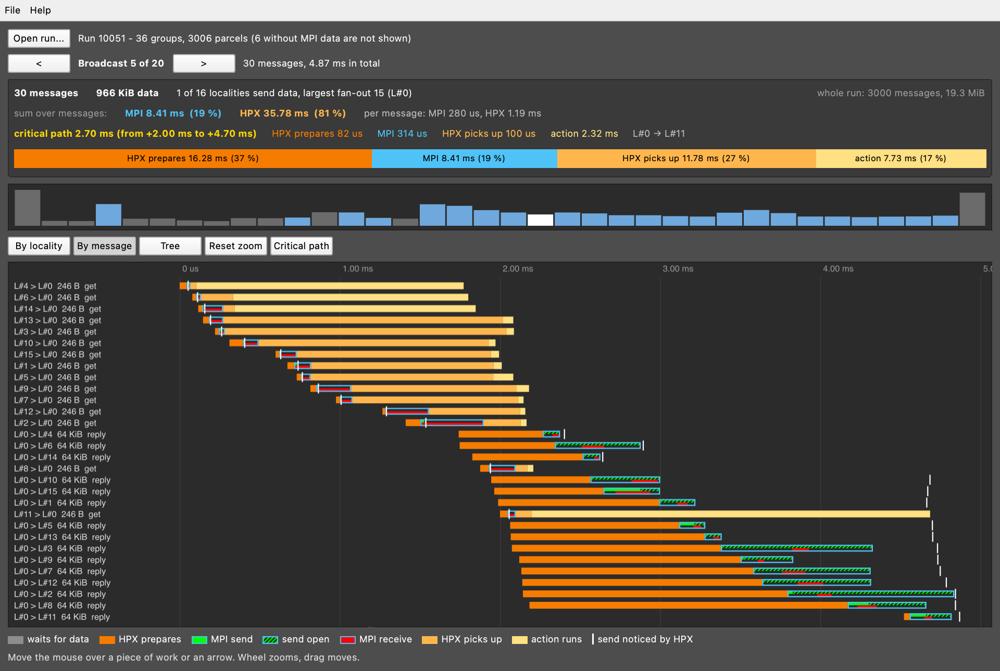
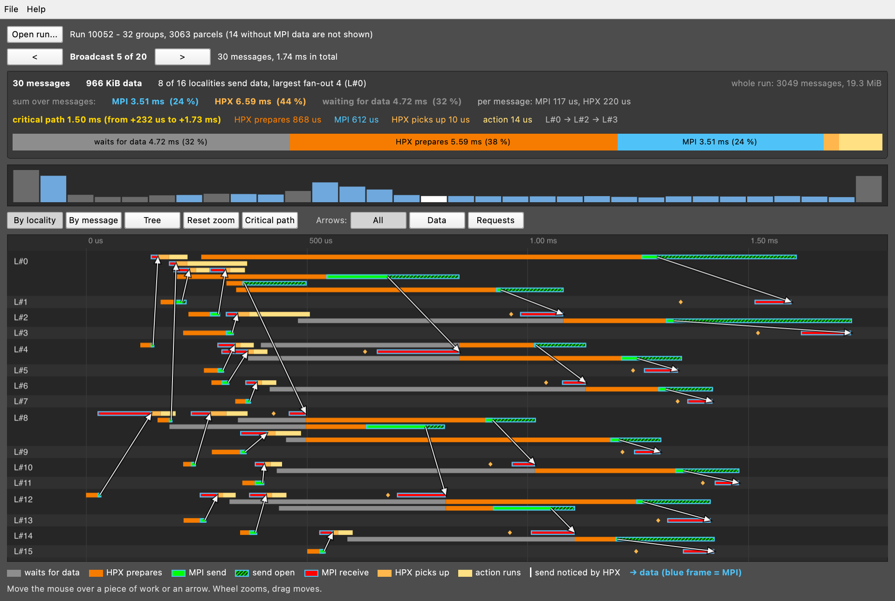

# EduHPX viewer

Qt 6 Quick app that opens an EduHPX run file (CSV, see [../docs/run_file_format.md](../docs/run_file_format.md)).
No database, no 3D view, no network.

## Build (Qt 6.5 or newer, CMake 3.19 or newer)

    cmake -S . -B build -DCMAKE_PREFIX_PATH=/path/to/Qt/6.x/<platform>
    cmake --build build

## Start

    build/eduhpx.app/Contents/MacOS/eduhpx run.csv     # macOS
    build/eduhpx run.csv                               # Linux, Windows

or start it without an argument and use *Open run...*, *File > Open*, drag a file onto the window, or *File > Examples*.

## A tour of the window

**Top:** the run, and the group you look at. Collectives (a broadcast) are one group each; everything else is cut into
bursts by pauses. `<` and `>` step through the groups. The strip under the summary shows all groups: blue-grey are
collectives, grey bursts, the white one is the group you look at.

**Summary:** number of messages and data volume of the group, and where the time went:

- *sum over messages* is the time of all messages added up (MPI and HPX). MPI is non-blocking, so these sums are not
  wall-clock time; the bars show the lifetime of each message.
- the **critical path** is the chain of messages that decided when the group finished, with its split into
  *HPX prepares*, *MPI*, *HPX picks up* and *action*. For a broadcast this is the number that matters.

**Views**

| Button | What you see |
|---|---|
| *By locality* | One lane per locality, in time. Arrows connect a send to its receive. The first lane (the root of a broadcast) is drawn in several rows, one per message. |
| *By message* | One row per message (`L4 > L0 246 B get`): the whole life of every message below each other. |
| *Tree* | The broadcast as a tree of localities: white arrows carry the data from the parent, orange arrows are the requests to the parent, the numbers are the time of each hop. |
| *Critical path* | Highlights the critical path in the view (on/off). |
| *Arrows* | All, only *Data* (the large messages) or only *Requests*. |
| *Reset zoom* | Mouse wheel zooms, dragging moves; this resets. |

Hover a piece of work or an arrow for its numbers (size, time in MPI, what HPX did).

### Colours

| | |
|---|---|
| grey | waits for data (the parent has not set it yet) |
| dark orange | HPX prepares the parcel |
| green | MPI send call |
| green striped | the send request is still open: MPI is still working on the message |
| red | MPI receive |
| blue frame | time inside MPI |
| light orange | HPX picks up the received message |
| yellow | the action runs |
| white tick | HPX notices that the message was sent |

Green and red are the same colours as in the EduMPI 3D view.

### By message

### Hierarchical broadcast

## Headless preview (for tests)

    QT_QPA_PLATFORM=offscreen QT_QUICK_BACKEND=software eduhpx ../examples/flat_broadcast_16loc_4nodes.csv \
        --render out/ broadcast:3:locality broadcast:3:tree

writes `out/broadcast3_locality.png` and `out/broadcast3_tree.png` (`kind:number:view`, view = locality | message | tree).
